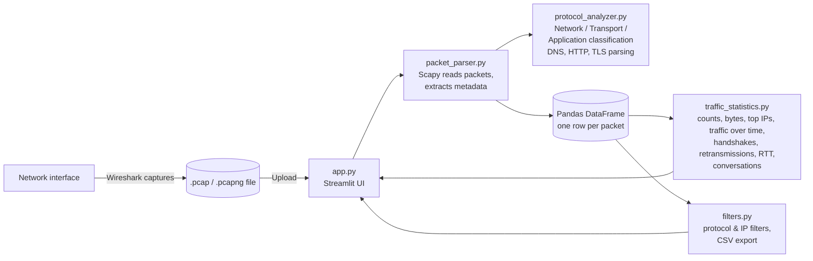
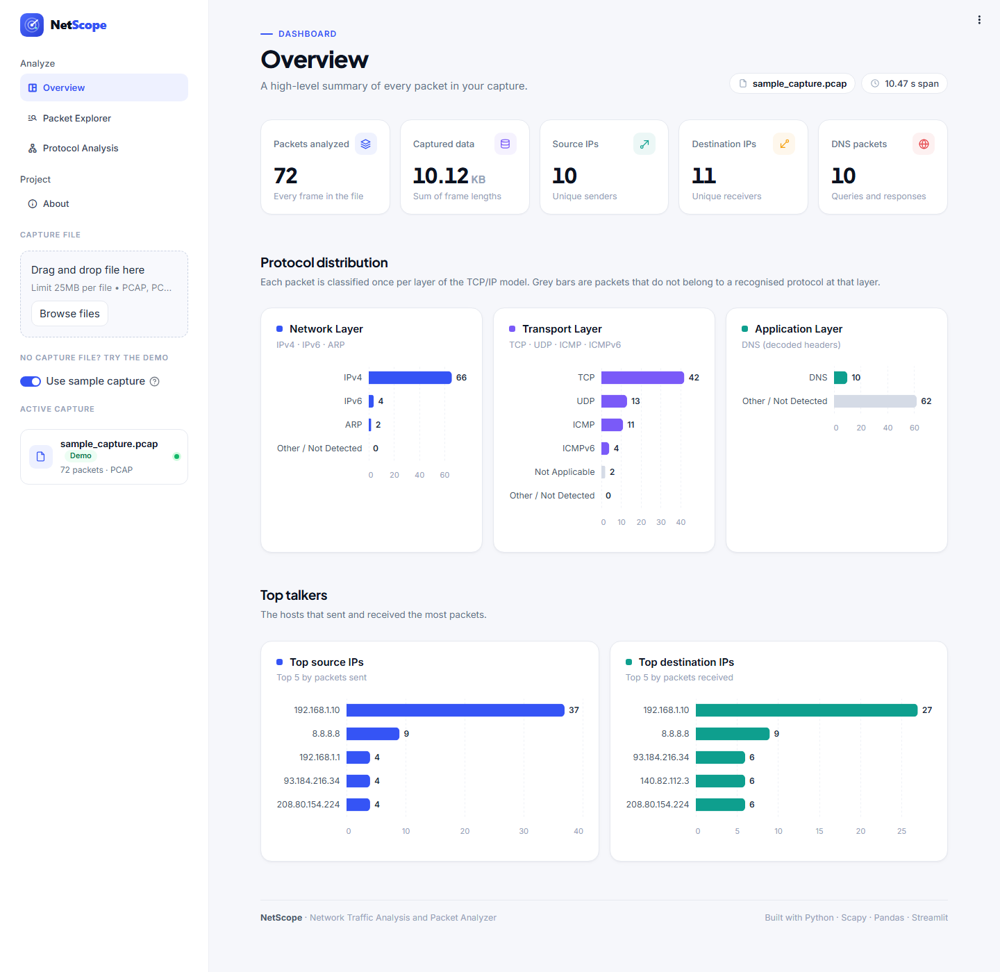
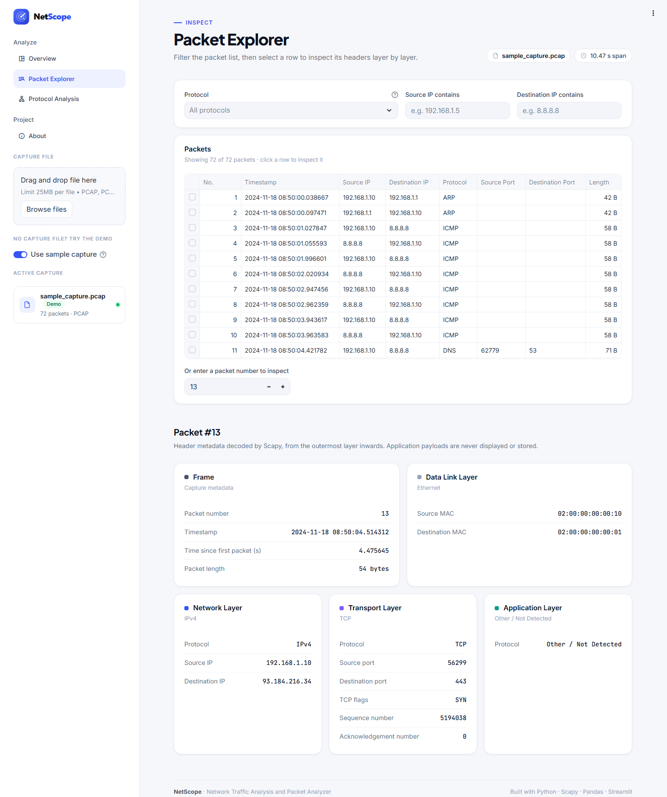
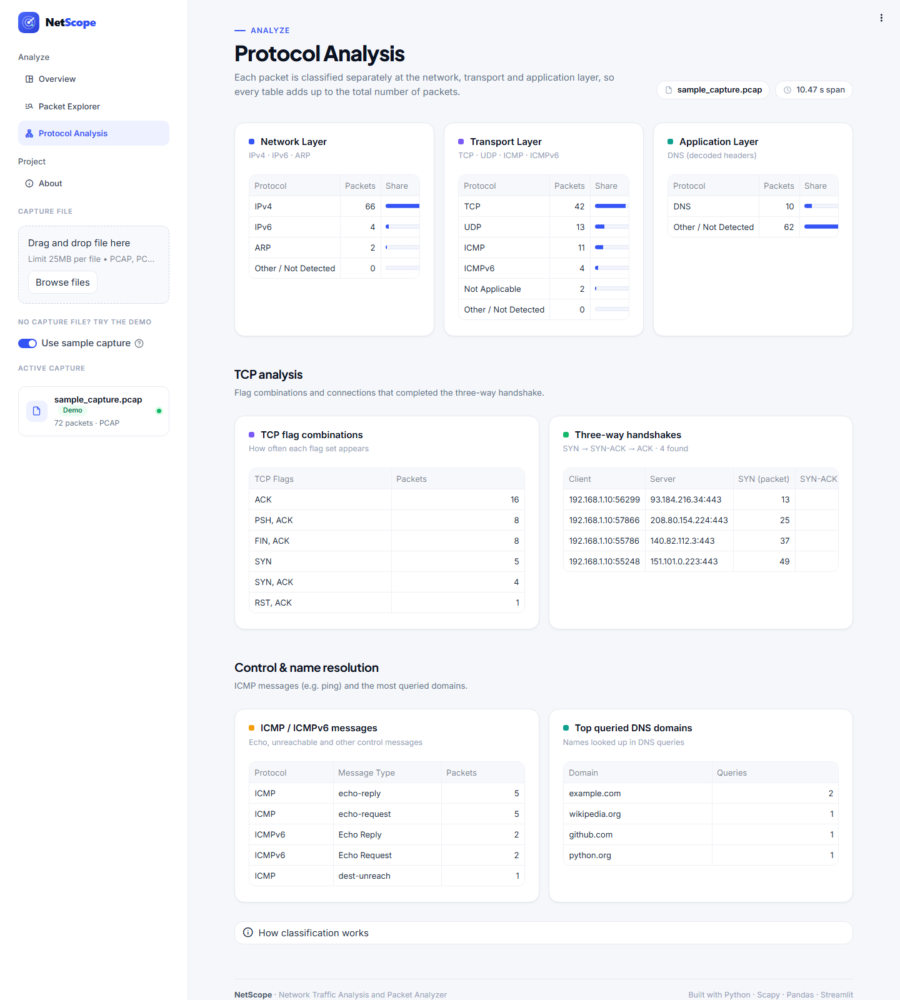
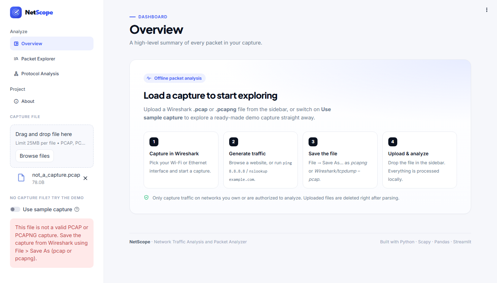

# NetScope – Network Traffic Analysis and Packet Analyzer

A Computer Networks mini-project that analyzes **real network packets captured with Wireshark**.
Upload a `.pcap` or `.pcapng` file and NetScope parses every packet with **Scapy**, identifies
protocols at the network, transport and application layers, and shows the results in a
**Streamlit** dashboard.

---

## 1. Introduction

Every action on a network (opening a website, sending a message, pinging a server) is carried
by small units of data called **packets**. Tools like Wireshark can record these packets, but the
raw capture is hard to read for a beginner. NetScope turns a capture file into clear statistics,
charts and a searchable packet table, so that networking concepts such as IP addressing, TCP/UDP,
DNS, ICMP and ARP can be seen in real traffic.

## 2. Problem Statement

Network captures contain thousands of packets with many nested protocol headers. Understanding
what kind of traffic is present — which hosts are talking, which protocols are used, how TCP
connections are set up — requires a tool that decodes each packet layer by layer and summarizes
the results accurately.

## 3. Objectives

- Read PCAP and PCAPNG files produced by Wireshark.
- Extract packet metadata: timestamps, MAC addresses, IP addresses, ports, lengths, TCP flags, DNS queries,
  HTTP request/status lines and TLS handshake details (version, SNI).
- Classify each packet separately at the **network**, **transport** and **application** layer.
- Show overall traffic statistics, protocol distributions and traffic over time.
- Provide a packet explorer with protocol and IP address filters and CSV export.
- Detect TCP three-way handshakes and retransmissions, and estimate round-trip time.
- Summarise conversations between pairs of IP addresses.
- Handle empty, corrupted and truncated files without crashing.

## 4. Technologies Used

| Technology | Purpose |
|---|---|
| Python 3 | Programming language |
| Scapy | Decoding packets from PCAP / PCAPNG files |
| Pandas | Packet table, filtering and statistics |
| Streamlit | Web dashboard (charts drawn with Altair, which ships with Streamlit) |
| Wireshark | Capturing packets and saving them to a file |
| pytest | Automated tests |

## 5. System Architecture



**Data flow:** the uploaded file is written to a temporary file → `packet_parser` reads it packet
by packet with Scapy → each packet becomes one row of metadata (classified by
`protocol_analyzer`) → the rows form a Pandas DataFrame → `traffic_statistics` and `filters`
work on that DataFrame → `app.py` displays the results. The temporary file is deleted right after
parsing.

## 6. Folder Structure

```
netscope/
├── app.py                     # Streamlit interface: pages, navigation, upload, demo toggle
├── netscope/
│   ├── __init__.py
│   ├── packet_parser.py       # Reads PCAP/PCAPNG, extracts per-packet metadata
│   ├── protocol_analyzer.py   # Layer-by-layer classification (incl. HTTP/TLS parsing) + distributions
│   ├── traffic_statistics.py  # Totals, top IPs, traffic over time, handshakes, retransmissions,
│   │                          # RTT, conversations, ICMP/DNS/HTTP/TLS summaries
│   ├── filters.py             # Protocol and IP address filters, CSV export
│   └── ui.py                  # Design system: colours, styles, cards, KPI tiles, charts
├── tests/
│   ├── conftest.py            # Synthetic test packets (used only in tests)
│   ├── test_packet_parser.py
│   ├── test_protocol_analyzer.py
│   └── test_future_scope.py   # HTTP/TLS, conversations, time chart, retransmission/RTT, CSV
├── assets/                    # NetScope logo (logo.svg, mark.svg)
├── sample_data/               # Synthetic demo captures (sample_capture.pcap, web_demo_capture.pcap)
├── tools/make_sample_capture.py     # Rebuilds the mixed-protocol demo capture with Scapy
├── tools/make_web_demo_capture.py   # Rebuilds the HTTP/TLS/retransmission demo capture
├── .streamlit/config.toml     # Brand theme (fonts, colours) and 25 MB upload limit
├── screenshots/               # App screenshots used in this README
├── requirements.txt
├── README.md
├── explain.md                 # Full guide: theory, demo files, every screen, how the code works
├── VIVA_PREPARATION.md
└── .gitignore
```

## 7. How the Application Works

1. **Validation** – the first 4 bytes of the file (the *magic number*) must identify a PCAP or
   PCAPNG file. Empty files and other file types are rejected with a clear message.
2. **Parsing** – Scapy's `PcapReader` reads packets one by one. For every packet NetScope records:
   packet number, timestamp, MAC addresses, IP addresses, ports, length, TCP flags and sequence
   numbers, TCP payload length, ICMP type, ARP operation, DNS query name, the HTTP request or
   status line and Host header, and the TLS record type, version and SNI server name.
3. **Classification** – each packet gets three independent labels:

   | Layer | Possible values |
   |---|---|
   | Network | IPv4, IPv6, ARP, Other / Not Detected |
   | Transport | TCP, UDP, ICMP, ICMPv6, Not Applicable (ARP), Other / Not Detected |
   | Application | DNS, HTTP, TLS, Other / Not Detected |

   - DNS is detected only when Scapy actually decodes a valid DNS header — not just because port 53 is used.
   - HTTP is detected only from a valid HTTP/1.x request line (`GET /path HTTP/1.1`) or status
     line (`HTTP/1.1 200 OK`) at the start of the TCP payload; TLS only from a valid TLS record
     header (content type 20–23, version 3.0–3.4). For a TLS Client Hello the server name (SNI)
     and offered version are read from its extensions. Port 443 is **not** assumed to be TLS and
     port 80 is **not** assumed to be HTTP; HTTP on port 8080 is still found by its content.
   - ARP has no IP header and no transport layer; its sender/target IP fields are shown as source/destination IP.
4. **Integrity check** – if the file was cut off in the middle of a packet, a warning is shown.
5. **Statistics and display** – everything shown is calculated from the uploaded packets.
   Filters create a new filtered table and never change the overall statistics.

**Privacy:** processing is completely local, the capture file is not kept, and application
payloads (the data inside packets) are never displayed or stored. Only protocol headers are
kept: the HTTP start line and Host header, never the HTTP body; for TLS only the record types,
version and SNI name, never the encrypted data.

**TCP analysis:**
- *Retransmission*: a segment that repeats a sequence number already sent with data (or SYN/FIN)
  in the same direction of the same connection. Pure ACKs and duplicate ACKs are not counted.
- *Round-trip time (RTT)*: for each segment, the time until the first ACK from the other side
  that covers it (ack ≥ seq + length, allowing for 32-bit wrap-around). Segments sent more than
  once are skipped (Karn's algorithm). RTT is reported per direction: in a capture taken on the
  client, *client → server* rows are the real network round trip, while *server → client* rows
  only show how fast the client replied. The handshake table also shows SYN → SYN-ACK time.

### Pages

| Page | Contents |
|---|---|
| Overview | Total packets, total captured bytes, unique source/destination IPs, DNS packet count, traffic-over-time chart (packets or bytes per interval), layer distribution charts, top 5 source and destination IPs |
| Packet Explorer | Packet table, filters (TCP, UDP, ICMP, ICMPv6, DNS, HTTP, TLS, ARP, IPv4, IPv6, source IP, destination IP), **Export CSV** of the filtered packets' metadata, packet details panel (incl. HTTP and TLS fields) |
| Protocol Analysis | Per-layer tables with counts and percentages, TCP flag combinations, completed three-way handshakes with handshake RTT, retransmissions, RTT per direction, HTTP requests with replies, TLS server names (SNI), IP conversations (packets and bytes per address pair, both directions), ICMP message types, top DNS domains |
| About | Project summary: workflow, concepts, technologies, privacy |

## 8. Installation (Windows PowerShell)

### 8.1 Install Python

Install Python 3.10 or newer from <https://www.python.org/downloads/> and tick
**"Add python.exe to PATH"** during setup. Check it:

```powershell
python --version
```

### 8.2 Download the project

```powershell
git clone https://github.com/anshika-006/cn-project.git
cd cn-project
```

Or use **Code → Download ZIP** on GitHub, extract it, and open PowerShell in the extracted
`cn-project` folder.

### 8.3 Install the dependencies

```powershell
python -m venv .venv
.\.venv\Scripts\Activate.ps1
python -m pip install -r requirements.txt
```

> If PowerShell blocks the activation script, run
> `Set-ExecutionPolicy -Scope CurrentUser RemoteSigned` once, then activate again.
> Using a virtual environment is optional; without it, just run the `pip install` line.

## 9. Installing and Using Wireshark

1. Download Wireshark from <https://www.wireshark.org/download.html> (Windows x64 Installer).
2. Run the installer and keep the default options. When asked, **install Npcap** — Wireshark needs
   it to capture packets on Windows.
3. Restart the computer if the installer asks.

NetScope itself does **not** need Npcap; it only reads saved files.

### 9.1 Capturing packets

> Only capture traffic on your own network or a network you are authorized to analyze.

1. Open Wireshark. The start screen lists your network interfaces with small traffic graphs.
2. Double-click the active interface (usually **Wi-Fi** or **Ethernet**). Capturing starts.
3. Generate some traffic. For a good demo, open PowerShell and run:

   ```powershell
   ping 8.8.8.8
   nslookup example.com
   ```

   and open a website in your browser.
4. Click the red **Stop** button (square) after 20–60 seconds.

### 9.2 Saving as PCAP / PCAPNG

1. Choose **File → Save As…**
2. In *Save as type*, choose either
   - **Wireshark/… – pcapng** (default, recommended), or
   - **Wireshark/tcpdump/… – pcap**
3. Save the file, e.g. `my_capture.pcapng`.

To save only some packets (e.g. after applying a display filter like `dns or icmp`), use
**File → Export Specified Packets…** and choose *All packets → Displayed*.

## 10. Running NetScope

```powershell
cd cn-project
python -m streamlit run app.py
```

The dashboard opens in your browser at <http://localhost:8501>. Upload your capture file using
the sidebar. Stop the server with **Ctrl + C** in PowerShell.

### Demo without a capture file

Switch on **Use sample capture** in the sidebar (just below the upload box) to load
`sample_data/sample_capture.pcap`. It contains 72 synthetic packets built with Scapy,
with no real traffic: ARP, ping (ICMP), DNS lookups, four TCP connections with full
three-way handshakes, a refused connection (RST), non-DNS UDP, IPv6 ICMPv6 pings and an
ICMP "destination unreachable". An uploaded file always takes priority over the sample.

A second demo file can be chosen in the drop-down under the switch:
**Web traffic: HTTP, TLS, retransmissions** (`sample_data/web_demo_capture.pcap`, 32 synthetic
packets). It has DNS lookups, an HTTP `GET /index.html` with a `200 OK` reply that is
retransmitted once, and a TLS 1.3 connection to `www.wikipedia.org` (Client Hello with SNI,
Server Hello, encrypted records filled with random bytes) in which one client segment is
retransmitted. The URL `?demo=1` opens the first demo, `?demo=web` the second.

To rebuild the demo files:

```powershell
python tools/make_sample_capture.py
python tools/make_web_demo_capture.py
```

### Running the tests

```powershell
python -m pytest -v
```

### Changing the upload limit

The limit (25 MB by default) is set in `.streamlit/config.toml`:

```toml
[server]
maxUploadSize = 25
```

## 11. Screenshots

Taken with the built-in demo file (**Use sample capture** switched on). These images were taken
before the traffic-over-time chart, CSV export, retransmission/RTT, web traffic and conversation
sections were added, so the current pages show more than the pictures.

**Overview:** summary tiles, protocol distribution per layer, top talkers



**Packet Explorer:** filters, packet table and layer-by-layer details (packet #13, a TCP SYN)



**Protocol Analysis:** per-layer tables, TCP flags, three-way handshakes, ICMP and DNS



**Error handling:** uploading a file that is not a real capture



## 12. Limitations

- Offline analysis only; there is no live capture.
- Application layer detection covers DNS, HTTP/1.x and TLS. Other protocols (e.g. QUIC,
  HTTP/2 without TLS, SMTP) are shown as *Other / Not Detected* instead of being guessed from
  port numbers.
- HTTP and TLS are detected per packet, without TCP stream reassembly: only a segment that
  starts with an HTTP start line or TLS record header is labelled, so later segments of a long
  HTTP body, or a TLS record that continues into the next segment, are *Other / Not Detected*.
- Encrypted traffic (HTTPS, DNS over HTTPS) cannot be inspected; only the TLS handshake
  metadata (record types, version, SNI) is visible. Encrypted Client Hello hides the real SNI.
- Retransmission and RTT analysis depend on where the capture was taken and do not detect
  fast retransmission, spurious retransmission or out-of-order segments separately.
- IP fragments are not reassembled; later fragments have no transport header and are counted as
  *Other / Not Detected* at the transport layer.
- Tunnelled traffic (VPN, GRE, IP-in-IP) is classified by the outermost header.
- Scapy is written in Python, so very large files are slow; the upload limit is 25 MB.
- Timestamps are shown in the computer's local time zone.
- mDNS (port 5353) is decoded by Scapy as DNS and counted as DNS. LLMNR is not counted as DNS.

## 13. Future Scope

Implemented from the original list: HTTP and TLS detection by header parsing (with SNI),
the conversation table, the traffic-over-time chart, TCP retransmission and RTT analysis,
and CSV export of filtered packet metadata.

Still open:
- Optional live capture with proper permissions (needs Npcap and administrator rights on Windows).
- TCP stream reassembly, so HTTP/TLS split over several segments is recognised.
- More application protocols (QUIC, DHCP, SMTP) and TLS certificate details for TLS 1.2.

## 14. Conclusion

NetScope demonstrates how network traffic is structured in layers and how a packet analyzer
decodes it. Using real Wireshark captures, it shows IP addressing, MAC addressing, TCP and UDP
communication, the TCP three-way handshake, retransmissions and round-trip time, ICMP messages,
ARP, DNS resolution, HTTP requests and the readable part of TLS handshakes, with every number
computed from the actual packets.
