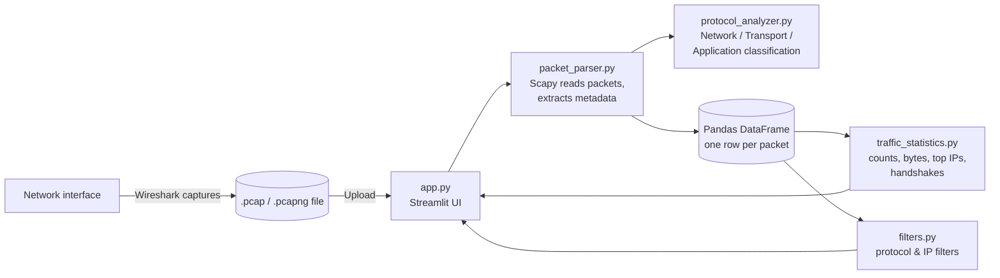

# NetScope – Network Traffic Analysis and Packet Analyzer

A Computer Networks mini-project that analyzes **real network packets captured with Wireshark**.
Upload a `.pcap` or `.pcapng` file and NetScope parses every packet with **Scapy**, identifies
protocols at the network, transport and application layers, and shows the results in a
**Streamlit** dashboard.

---

## 1. Introduction

Every action on a network (opening a website, sending a message, pinging a server) is carried
by small units of data called **packets**. Tools like Wireshark can record these packets, but the
raw capture is hard to read for a beginner. NetScope turns a capture file into clear statistics,
charts and a searchable packet table, so that networking concepts such as IP addressing, TCP/UDP,
DNS, ICMP and ARP can be seen in real traffic.

## 2. Problem Statement

Network captures contain thousands of packets with many nested protocol headers. Understanding
what kind of traffic is present — which hosts are talking, which protocols are used, how TCP
connections are set up — requires a tool that decodes each packet layer by layer and summarizes
the results accurately.

## 3. Objectives

- Read PCAP and PCAPNG files produced by Wireshark.
- Extract packet metadata: timestamps, MAC addresses, IP addresses, ports, lengths, TCP flags, DNS queries.
- Classify each packet separately at the **network**, **transport** and **application** layer.
- Show overall traffic statistics and protocol distributions.
- Provide a packet explorer with protocol and IP address filters.
- Detect TCP three-way handshakes.
- Handle empty, corrupted and truncated files without crashing.

## 4. Technologies Used

| Technology | Purpose |
|---|---|
| Python 3 | Programming language |
| Scapy | Decoding packets from PCAP / PCAPNG files |
| Pandas | Packet table, filtering and statistics |
| Streamlit | Web dashboard (charts drawn with Altair, which ships with Streamlit) |
| Wireshark | Capturing packets and saving them to a file |
| pytest | Automated tests |

## 5. System Architecture



**Data flow:** the uploaded file is written to a temporary file → `packet_parser` reads it packet
by packet with Scapy → each packet becomes one row of metadata (classified by
`protocol_analyzer`) → the rows form a Pandas DataFrame → `traffic_statistics` and `filters`
work on that DataFrame → `app.py` displays the results. The temporary file is deleted right after
parsing.

## 6. Folder Structure

```
netscope/
├── app.py                     # Streamlit interface (pages, upload, charts, tables)
├── netscope/
│   ├── __init__.py
│   ├── packet_parser.py       # Reads PCAP/PCAPNG, extracts per-packet metadata
│   ├── protocol_analyzer.py   # Layer-by-layer protocol classification + distributions
│   ├── traffic_statistics.py  # Totals, unique IPs, top IPs, TCP/ICMP/DNS summaries
│   └── filters.py             # Protocol and IP address filters
├── tests/
│   ├── conftest.py            # Synthetic test packets (used only in tests)
│   ├── test_packet_parser.py
│   └── test_protocol_analyzer.py
├── .streamlit/config.toml     # Light theme and 25 MB upload limit
├── screenshots/               # Put your application screenshots here
├── requirements.txt
├── README.md
├── VIVA_PREPARATION.md
└── .gitignore
```

## 7. How the Application Works

1. **Validation** – the first 4 bytes of the file (the *magic number*) must identify a PCAP or
   PCAPNG file. Empty files and other file types are rejected with a clear message.
2. **Parsing** – Scapy's `PcapReader` reads packets one by one. For every packet NetScope records:
   packet number, timestamp, MAC addresses, IP addresses, ports, length, TCP flags and sequence
   numbers, ICMP type, ARP operation and DNS query name.
3. **Classification** – each packet gets three independent labels:

   | Layer | Possible values |
   |---|---|
   | Network | IPv4, IPv6, ARP, Other / Not Detected |
   | Transport | TCP, UDP, ICMP, ICMPv6, Not Applicable (ARP), Other / Not Detected |
   | Application | DNS, Other / Not Detected |

   - DNS is detected only when Scapy actually decodes a valid DNS header — not just because port 53 is used.
   - Port 443 is **not** assumed to be TLS and port 80 is **not** assumed to be HTTP.
   - ARP has no IP header and no transport layer; its sender/target IP fields are shown as source/destination IP.
4. **Integrity check** – if the file was cut off in the middle of a packet, a warning is shown.
5. **Statistics and display** – everything shown is calculated from the uploaded packets.
   Filters create a new filtered table and never change the overall statistics.

**Privacy:** processing is completely local, the capture file is not kept, and application
payloads (the data inside packets) are never displayed or stored.

### Pages

| Page | Contents |
|---|---|
| Overview | Total packets, total captured bytes, unique source/destination IPs, DNS packet count, layer distribution charts, top 5 source and destination IPs |
| Packet Explorer | Packet table, filters (TCP, UDP, ICMP, ICMPv6, DNS, ARP, IPv4, IPv6, source IP, destination IP), packet details panel |
| Protocol Analysis | Per-layer tables with counts and percentages, TCP flag combinations, completed three-way handshakes, ICMP message types, top DNS domains |
| About Project | Project summary |

## 8. Installation (Windows PowerShell)

### 8.1 Install Python

Install Python 3.10 or newer from <https://www.python.org/downloads/> and tick
**"Add python.exe to PATH"** during setup. Check it:

```powershell
python --version
```

### 8.2 Install the dependencies

```powershell
cd C:\Users\<your-name>\netscope
python -m venv .venv
.\.venv\Scripts\Activate.ps1
python -m pip install -r requirements.txt
```

> If PowerShell blocks the activation script, run
> `Set-ExecutionPolicy -Scope CurrentUser RemoteSigned` once, then activate again.
> Using a virtual environment is optional; without it, just run the `pip install` line.

## 9. Installing and Using Wireshark

1. Download Wireshark from <https://www.wireshark.org/download.html> (Windows x64 Installer).
2. Run the installer and keep the default options. When asked, **install Npcap** — Wireshark needs
   it to capture packets on Windows.
3. Restart the computer if the installer asks.

NetScope itself does **not** need Npcap; it only reads saved files.

### 9.1 Capturing packets

> Only capture traffic on your own network or a network you are authorized to analyze.

1. Open Wireshark. The start screen lists your network interfaces with small traffic graphs.
2. Double-click the active interface (usually **Wi-Fi** or **Ethernet**). Capturing starts.
3. Generate some traffic. For a good demo, open PowerShell and run:

   ```powershell
   ping 8.8.8.8
   nslookup example.com
   ```

   and open a website in your browser.
4. Click the red **Stop** button (square) after 20–60 seconds.

### 9.2 Saving as PCAP / PCAPNG

1. Choose **File → Save As…**
2. In *Save as type*, choose either
   - **Wireshark/… – pcapng** (default, recommended), or
   - **Wireshark/tcpdump/… – pcap**
3. Save the file, e.g. `my_capture.pcapng`.

To save only some packets (e.g. after applying a display filter like `dns or icmp`), use
**File → Export Specified Packets…** and choose *All packets → Displayed*.

## 10. Running NetScope

```powershell
cd C:\Users\<your-name>\netscope
python -m streamlit run app.py
```

The dashboard opens in your browser at <http://localhost:8501>. Upload your capture file using
the sidebar. Stop the server with **Ctrl + C** in PowerShell.

### Demo without a capture file

Switch on **Use sample capture** in the sidebar (just below the upload box) to load
`sample_data/sample_capture.pcap`. It contains 72 synthetic packets built with Scapy,
with no real traffic: ARP, ping (ICMP), DNS lookups, four TCP connections with full
three-way handshakes, a refused connection (RST), non-DNS UDP, IPv6 ICMPv6 pings and an
ICMP "destination unreachable". An uploaded file always takes priority over the sample.
To rebuild it:

```powershell
python tools/make_sample_capture.py
```

### Running the tests

```powershell
python -m pytest -v
```

### Changing the upload limit

The limit (25 MB by default) is set in `.streamlit/config.toml`:

```toml
[server]
maxUploadSize = 25
```

## 11. Screenshots

Screenshots are not included because they should show your own capture. To add them:

1. Run NetScope and upload a capture.
2. Take screenshots with **Win + Shift + S** of: Overview, Packet Explorer (with a packet
   selected), Protocol Analysis, and an error message (e.g. after uploading a non-capture file).
3. Save them in the `screenshots/` folder as `overview.png`, `packet_explorer.png`,
   `protocol_analysis.png`, `error_handling.png`.
4. Uncomment the lines below.

<!--


-->

## 12. Limitations

- Offline analysis only; there is no live capture.
- Application layer detection is limited to DNS. HTTP, TLS and others are shown as
  *Other / Not Detected* instead of being guessed from port numbers.
- Encrypted traffic (HTTPS, DNS over HTTPS) cannot be inspected.
- IP fragments are not reassembled; later fragments have no transport header and are counted as
  *Other / Not Detected* at the transport layer.
- Tunnelled traffic (VPN, GRE, IP-in-IP) is classified by the outermost header.
- Scapy is written in Python, so very large files are slow; the upload limit is 25 MB.
- Timestamps are shown in the computer's local time zone.
- mDNS (port 5353) is decoded by Scapy as DNS and counted as DNS. LLMNR is not counted as DNS.

## 13. Future Scope

- HTTP and TLS detection by real header parsing (e.g. TLS Client Hello / SNI).
- Conversation / flow table (packets and bytes per IP pair).
- Traffic-over-time chart.
- TCP retransmission and RTT analysis.
- Export of filtered packet metadata to CSV.
- Optional live capture with proper permissions.

## 14. Conclusion

NetScope demonstrates how network traffic is structured in layers and how a packet analyzer
decodes it. Using real Wireshark captures, it shows IP addressing, MAC addressing, TCP and UDP
communication, the TCP three-way handshake, ICMP messages, ARP and DNS resolution, with every
number computed from the actual packets.
